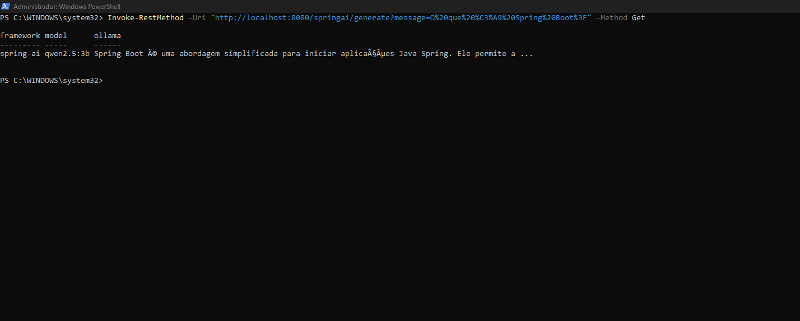
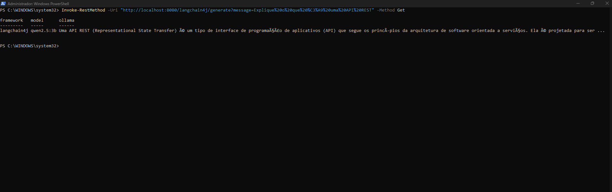
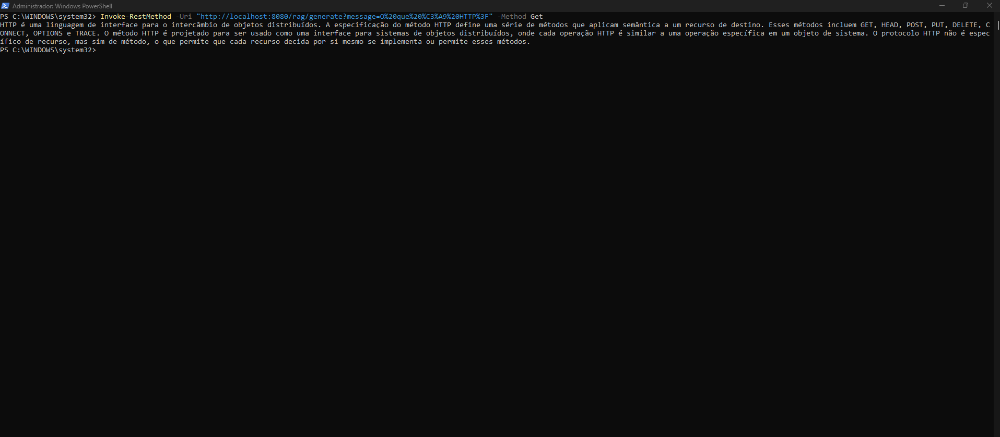
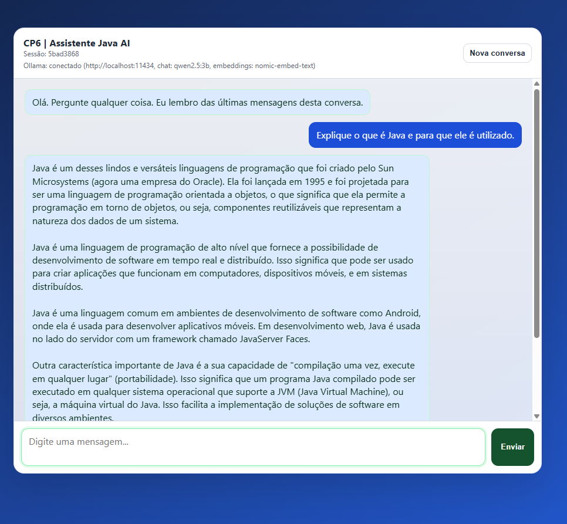

# CP6 | Java Advanced — Spring AI + LangChain4j + Ollama

Projeto Java com integração local ao Ollama, geração de respostas por Spring AI e LangChain4j, consulta com RAG e chatbot web. O trabalho foi desenvolvido a partir de um projeto de referência para estudo e adaptação.

## Tecnologias e requisitos

- Java (projeto configurado para Java 21; executado localmente com Java 25)
- Spring Boot, Spring AI e LangChain4j
- Ollama com `qwen2.5:3b` para geração de texto, **diferente de Gemma e Llama**
- Ollama com `nomic-embed-text` para embeddings do RAG
- Gradle Wrapper (incluído no repositório)

## Instalação e execução no Windows

Instale o [Ollama](https://ollama.com/download/windows), abra um terminal e execute:

```powershell
ollama pull qwen2.5:3b
ollama pull nomic-embed-text
ollama list
```

Com o Ollama ativo, abra outro terminal na raiz do projeto e execute:

```powershell
.\gradlew.bat bootRun
```

Abra o chatbot em **http://localhost:8080**. Os endpoints abaixo podem ser testados pelo PowerShell com `Invoke-RestMethod`. A primeira resposta pode demorar enquanto o Ollama carrega o modelo.

## Evidências dos testes

As capturas abaixo são de testes realizados localmente com a aplicação em execução. Cada seção registra a pergunta utilizada e o resultado observado.

### 1. Spring AI — `/springai/generate`

**Pergunta:** O que é Spring Boot?

```powershell
Invoke-RestMethod -Uri "http://localhost:8080/springai/generate?message=O%20que%20%C3%A9%20Spring%20Boot%3F" -Method Get
```

**Resultado e comentário:** o endpoint retornou uma resposta sobre Spring Boot e identificou `spring-ai` como framework e `qwen2.5:3b` como modelo. O resultado confirma a chamada funcional à API de geração com Spring AI e Ollama. Alguns caracteres acentuados apareceram incorretamente no PowerShell, por questão de exibição/codificação do terminal.



### 2. LangChain4j — `/langchain4j/generate`

**Pergunta:** Explique o que é uma API REST.

```powershell
Invoke-RestMethod -Uri "http://localhost:8080/langchain4j/generate?message=Explique%20o%20que%20%C3%A9%20uma%20API%20REST" -Method Get
```

**Resultado e comentário:** o endpoint retornou uma explicação de API REST e apresentou `langchain4j` e `qwen2.5:3b` na resposta. Isso demonstra o funcionamento da integração LangChain4j com o modelo local. Também houve caracteres acentuados exibidos incorretamente no terminal.



### 3. RAG — `/rag/generate`

**Pergunta:** O que é HTTP?

```powershell
Invoke-RestMethod -Uri "http://localhost:8080/rag/generate?message=O%20que%20%C3%A9%20HTTP%3F" -Method Get
```

**Resultado e comentário:** o endpoint retornou uma explicação sobre HTTP, incluindo seus métodos, sem apresentar erro HTTP 500 ou 501. O projeto usa o documento `rfc7231.txt` como fonte para a recuperação de informações com embeddings. O print confirma o retorno do endpoint, mas não exibe os trechos recuperados internamente.



### 4. Chatbot — `localhost:8080`

**Pergunta:** Explique o que é Java e para que ele é utilizado.

**Resultado e comentário:** a interface carregou no navegador, exibiu a conexão com o Ollama e apresentou uma resposta extensa sobre Java, sua portabilidade e aplicações. O teste demonstra o funcionamento da interface e da geração de resposta por meio do modelo `qwen2.5:3b`.



## Endpoints disponíveis

| Método | Rota | Finalidade |
|---|---|---|
| GET | `/springai/generate` | Geração com Spring AI |
| GET | `/langchain4j/generate` | Geração com LangChain4j |
| GET | `/rag/generate` | Resposta com recuperação de contexto (RAG) |
| GET | `/` | Interface web do chatbot |
| POST | `/springai/chat` | Chat com memória curta usado pela interface |

## Atenção ao modelo de embeddings

Se alterar o modelo de embeddings, **remova o arquivo `vectorstore.json` da raiz do projeto** antes de testar novamente `/rag/generate`. Assim, o arquivo poderá ser recriado com os vetores do modelo escolhido. Reutilizar um banco vetorial gerado com embeddings incompatíveis pode causar erros 500 ou 501.

O modelo atual de embeddings é `nomic-embed-text`, configurado em `src/main/resources/application.properties`.

## Observações

- Os prints documentam os testes manuais realizados no Windows com Ollama ativo.
- O repositório deve ser publicado como **público** no GitHub para entrega.
- Para executar os testes automatizados do Gradle, use `.\gradlew.bat test`.
